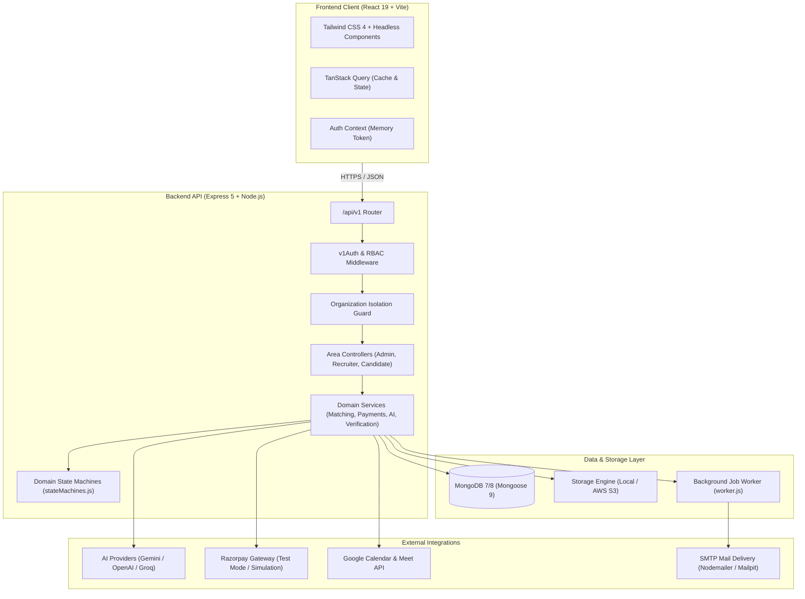

# HireSmart AI

[](https://github.com/anastai8704/HireSmart-AI/actions/workflows/ci.yml)
[](https://nodejs.org/)
[](LICENSE)

**HireSmart AI** is an enterprise-grade, AI-powered Applicant Tracking System (ATS) and recruitment management platform. It streamlines the end-to-end hiring lifecycle across three dedicated role-based workspaces: **Candidates**, **Recruiters & Hiring Teams**, and **Platform Administrators**.

The platform bridges the communication and efficiency gap in modern hiring: candidates receive explainable ATS scoring and intelligent career guidance, recruiters automate candidate evaluation and pipeline operations with deep insights, and platform administrators oversee compliance, security, moderation, and billing.

---

## 1. Academic Project Information

HireSmart AI was developed as an **MCA Semester 3** academic project, demonstrating production-grade software engineering, secure multi-tenant architecture, explainable AI pipelines, and resilient distributed design.

### Project Team

| Team Member | Role | Enrollment Number |
| :--- | :--- | :--- |
| **Anas Tai** | Project Lead | 202504104610150 |
| **Palak Mehta** | Developer | 202504104610145 |
| **Zaid Malek** | Developer | 202504104610135 |
| **Suraj Pandey** | Developer | 202504104610094 |

---

## 2. Main Workspaces & Features

### Candidate Workspace
- **Personalized Dashboard:** Live application status counters, profile completion tracking, and upcoming scheduled interviews.
- **Job Discovery & Saved Jobs:** Filter published requisitions by location, salary, experience, and workplace mode (onsite, hybrid, remote).
- **Persistent Job Alerts:** Automated email and in-app alerts tailored to specific job search queries and cadences.
- **Resume Manager:** Upload, parse, and version resumes (PDF/DOCX) with SHA-256 duplicate detection and secure S3/local storage.
- **ATS Resume Analyzer:** Detailed fit analysis against job descriptions with a component score breakdown (required skills, preferred skills, experience, education, semantic similarity).
- **Career AI Copilot:** Interactive, full-page AI copilot providing resume improvement feedback, interview preparation tips, and career guidance.
- **Application Tracking:** Real-time visibility into application stages (`submitted`, `under_review`, `shortlisted`, `interview`, `offer`, `hired`).
- **Interviews & Calendar:** Access confirmed meeting links (Google Meet / manual) with time-gated candidate join controls.
- **Offers & Placement:** Review formal pre-hire compensation details, accept or decline offers, and submit post-hire joining confirmation.
- **Profile & Subscription:** Manage contact information, skills taxonomy, DPDP/GDPR consent preferences, and Candidate Plus subscription plans.

### Recruiter Workspace
- **Recruiter Dashboard & Analytics:** Hiring pipeline conversion funnels, time-to-hire metrics, requisition statuses, and team activity streams.
- **Company Profile & Verification:** Submit company registration credentials (GSTIN, CIN, domain ownership) for administrative platform verification.
- **Team Management:** Invite colleagues into role-based permissions (`owner`, `hiring_manager`, `interviewer`, `viewer`).
- **Requisitions & Job Management:** Create, edit, and publish job requisitions with compensation ranges, AI-assisted JD generation, and required skill tags.
- **Applications Pipeline:** Interactive candidate stage progression with drag-and-drop or batch status updates, private notes, and rating scorecards.
- **Candidate 360 Profile:** Complete candidate journey view including extracted resume details, portfolio links, and match scores.
- **Candidate Comparison:** Multi-applicant comparison matrix highlighting matched vs. missing requirements side-by-side without automated bias.
- **Interview Scheduling:** Job-bound scheduling with timezone awareness, evaluator scorecards, and optional Google Calendar integration.
- **Offers & Hiring Management:** Draft, issue, and manage pre-hire offers with CTC, base salary, bonus, and joining dates.
- **Recruitment AI Copilot:** AI assistant providing customized interview question generation, JD optimization, and candidate summary synthesis.
- **Billing & Subscriptions:** Tiered plans (`Enterprise`, `Growth`, `Starter`, `Free`) with team seat and job quota tracking.

### Admin Workspace
- **Platform Control Center:** System-wide operations, active tenant counts, user registrations, revenue metrics, and server health.
- **Company Governance:** Review pending organization verification cases, inspect submitted legal documents, and verify or reject organizations.
- **Job Moderation:** Enforce compliance on published requisitions with an append-only moderation state machine (`approved`, `rejected`, `changes_requested`).
- **Candidate & User Directory:** Global user directory with role filtering, account status management, and audit inspection.
- **Candidate 360 Oversight:** Full audit inspection of candidate activities, applications, and security events across all tenants.
- **Placements & Employment Overview:** Track placements across companies, canonical employment statuses, and verify proof of joining.
- **Security & Fraud Detection:** Audit trails, failed authentication tracking, session revocation, and security event investigations.
- **Revenue & Transactions:** Financial transaction tracking, plan subscription ledger, and Razorpay Test Mode reconciliation.
- **Subscriptions & Quota Oversight:** Manage tenant limits, upgrade overrides, and usage quota enforcement.
- **Reports & Data Exports:** Authorised CSV export engine with automated spreadsheet formula-injection sanitization.
- **Platform Settings & Configuration:** Dynamic platform setting management, feature flags, and maintenance controls.

---

## 3. System Architecture

HireSmart AI utilizes a modular monolith pattern with an asynchronous worker queue, prioritizing tenancy boundaries and security.



---

## 4. AI Architecture & Integration

HireSmart AI implements an explainable, resilient AI pipeline designed to assist humans rather than make autonomous hiring decisions:

- **Primary & Fallback Providers:** Built on an OpenAI-compatible adapter supporting Google Gemini, Groq, OpenAI, or local endpoints with automated fallback handling.
- **Structured Outputs via Zod:** AI outputs are strictly constrained to typed JSON schemas, guaranteeing schema stability and predictable UI rendering.
- **ATS Resume Analyzer:** Deterministic hybrid scoring combining:
  - Required skills match (weighted)
  - Preferred skills match
  - Experience years & seniority alignment
  - Education level verification
  - Semantic content similarity (vector embeddings or deterministic TF-IDF fallback)
- **Candidate Career Copilot:** Natural language coaching for resume gap identification, interview readiness, and application preparation.
- **Recruiter Recruitment Copilot:** Context-aware assistant for job requisition drafting, customized interview question kits, and candidate synthesis.
- **Privacy & Redaction:** Protected candidate personal attributes (gender, age, photo, address, contact identifiers) are excluded from AI ranking inputs to prevent bias.

---

## 5. Technology Stack

| Layer | Technologies |
| :--- | :--- |
| **Frontend** | React 19, Vite 8, React Router 7, Tailwind CSS 4, TanStack Query v5, React Hook Form, Zod, Recharts, Lucide Icons |
| **Backend** | Node.js (20 LTS / 22), Express 5, Mongoose 9, Multer, Helmet, CORS, Compression, HPP, express-mongo-sanitize |
| **Database** | MongoDB (v7 / v8) with replica set support and 33 interconnected domain collections |
| **Authentication** | JWT access tokens (in-memory), rotating HTTP-only refresh cookies, double-submit CSRF tokens, bcryptjs (cost 12) |
| **AI Integration** | Modular provider orchestrator (Google Gemini, Groq, OpenAI), Zod schema validation, TF-IDF / vector embeddings |
| **Payments** | Razorpay SDK (Test Mode only) and sandboxed simulation transactions |
| **File Storage** | AWS S3 SDK (`@aws-sdk/client-s3`) and local private disk storage with magic-number validation |
| **Document Processing** | `pdf-parse`, `mammoth` (DOCX parsing), crypto SHA-256 fingerprinting |
| **Email Delivery** | Nodemailer with SMTP queue, Mailpit (local Docker testing) |
| **Testing** | Node test runner (`node:test`), Supertest, Vitest, Playwright E2E |
| **Deployment** | Docker multi-stage builds (Node API image, Nginx static web image), Docker Compose |

---

## 6. Installation & Local Setup

### Prerequisites
- **Node.js:** v20.0.0 or higher (v22 recommended)
- **MongoDB:** v7.0 or higher running locally on port `27017` (or MongoDB Atlas)
- **Git**

### Step 1: Clone Repository
```bash
git clone https://github.com/anastai8704/HireSmart-AI.git
cd HireSmart-AI
```

### Step 2: Install Dependencies
```bash
# Install server dependencies
cd server
npm install

# Install client dependencies
cd ../client
npm install
cd ..
```
*(On Windows, you can alternatively run `.\setup.ps1`; on Linux/macOS, run `./setup.sh`)*

### Step 3: Environment Setup
Copy the example environment configuration:
```bash
cp server/.env.example server/.env
```
Open `server/.env` and configure your local settings:
- `MONGO_URI=mongodb://127.0.0.1:27017/hiresmart_ai`
- `JWT_SECRET=your_super_secret_jwt_key_at_least_32_characters_long`
- Configure optional AI and payment providers as needed (placeholders provided).

### Step 4: Database Seeding (Local Development)
To load a fresh, interconnected demo dataset with verified organizations, candidate profiles, jobs, applications, and interviews:
```bash
cd server
npm run seed:fresh:confirm
```

### Step 5: Start Development Servers
Run the backend and frontend in separate terminals:

```bash
# Terminal 1: Backend API (http://localhost:5000)
cd server
npm run dev

# Terminal 2: Frontend Web Client (http://localhost:5173)
cd client
npm run dev
```

Visit **`http://localhost:5173`** in your browser.

---

## 7. Environment Variables Reference

Reference configuration template: `server/.env.example`

| Variable | Description | Example / Default |
| :--- | :--- | :--- |
| `NODE_ENV` | Application runtime environment | `development` / `production` |
| `PORT` | API server port | `5000` |
| `MONGO_URI` | MongoDB connection URI | `mongodb://127.0.0.1:27017/hiresmart_ai` |
| `CLIENT_URL` | Frontend client URL (CORS & links) | `http://localhost:5173` |
| `JWT_SECRET` | Secret key for signing access tokens | `your_random_32_character_secret` |
| `ACCESS_TOKEN_EXPIRES_IN`| In-memory access token validity | `15m` |
| `REFRESH_TOKEN_EXPIRES_DAYS`| Rotating refresh cookie validity | `30` |
| `STORAGE_PROVIDER` | Resume and document storage engine | `local` (or `s3`) |
| `AI_PRIMARY_PROVIDER` | Primary AI integration provider | `gemini` (or `groq`, `openai`) |
| `AI_PRIMARY_MODEL` | Primary AI model identifier | `gemini-1.5-flash` |
| `AI_PRIMARY_API_KEY` | Primary provider API key | `your_api_key_here` |
| `AI_FALLBACK_PROVIDER` | Fallback AI provider | `groq` |
| `PAYMENT_MODE` | Payment processing gateway mode | `simulation` (or `razorpay_test`) |
| `RAZORPAY_KEY_ID` | Razorpay Test Key ID | `rzp_test_your_key_id` |
| `RAZORPAY_KEY_SECRET` | Razorpay Test Key Secret | `your_key_secret` |

*Note: Never commit actual `.env` files. Keep production secrets in a secure secret manager.*

---

## 8. Database & Seeding Management

HireSmart AI includes safe, repeatable seeding tools located in `server/scripts/`:

```bash
# Non-destructive preview of database state
npm run seed:fresh

# Full safe reset & fresh system-aligned seed (creates automatic backup first)
npm run seed:fresh:confirm

# Relational cross-reference verification (checks for orphaned records)
npm run seed:verify

# Standalone full database backup (EJSON format saved to server/backups/)
npm run db:backup
```

> **Warning:** Reset commands delete application demo records. They strictly refuse to run in `production` (`NODE_ENV=production`) and require explicit CLI confirmation.

---

## 9. Security & Governance Controls

- **Authentication Safeguards:** Passwords hashed with bcrypt (cost factor 12), timing-safe comparisons for unknown emails, and brute-force IP/account rate limits.
- **Session Architecture:** 15-minute access tokens stored strictly in memory; rotating refresh tokens in `HttpOnly`, `SameSite: Lax` cookies with reuse detection that revokes entire compromised session families.
- **CSRF Defense:** Double-submit cookie pattern (`hiresmart_csrf`) enforced on token rotation and state-changing requests.
- **Tenant Isolation:** Multi-tenant scoping enforced at route, controller, and query levels using `req.auth.organizationId`.
- **RBAC & Admin Guarding:** Platform admin endpoints return 404 to unauthorized users, completely hiding administrative surfaces.
- **Document & File Safety:** Magic-number MIME verification, random UUID storage filenames, and private streaming routes preventing direct public bucket exposure.
- **Audit Logging & Security Events:** Append-only logging of administrative actions, organization status changes, and sensitive candidate access.
- **Formula Injection Mitigation:** CSV exports sanitize leading formula triggers (`=`, `+`, `-`, `@`) to protect spreadsheets.

---

## 10. Testing & Verification

```bash
# 1. Server syntax validation
cd server
npm run check

# 2. Server unit test suite (no database required)
node --test test/*.unit.test.js

# 3. Server integration tests (requires MongoDB)
npm test

# 4. Frontend component and unit tests
cd ../client
npx vitest run

# 5. Frontend & Backend linting
npm run lint

# 6. Production client build
npm run build
```

---

## 11. Project Directory Structure

```
HireSmart-AI/
├── client/                     # Frontend React SPA
│   ├── public/                 # Static assets, logos, and PWA manifests
│   ├── src/
│   │   ├── components/         # Reusable UI, admin, hiring, and AI components
│   │   ├── context/            # AuthContext and application providers
│   │   ├── hooks/              # Custom React hooks (checkout, entitlement)
│   │   ├── lib/                # API client, date formatting, and utilities
│   │   ├── pages/              # Candidate, Recruiter, Admin, and Auth screens
│   │   └── security/           # Client-side protected route boundaries
│   ├── package.json
│   └── vite.config.js
├── server/                     # Backend Express API & Worker
│   ├── config/                 # Environment validation and plan catalogs
│   ├── constants/              # System enums and fixed definitions
│   ├── controllers/            # Role-based HTTP request handlers
│   ├── domain/                 # Pure business rules and state machines
│   ├── middleware/             # Auth, organization check, uploads, and errors
│   ├── models/                 # Mongoose schemas and data models
│   ├── routes/                 # /api/v1 route table
│   ├── scripts/                # Seeding, backup, and migration utilities
│   ├── services/               # Matching engine, AI orchestrator, payments
│   ├── test/                   # Unit and integration test suites
│   ├── app.js                  # Express application setup
│   ├── server.js               # Server bootstrap and database connection
│   └── worker.js               # Background queue processor
├── docs/                       # Technical architecture documentation
├── .github/workflows/          # CI pipeline definitions
├── docker-compose.yml          # Container orchestration (API, Mongo, Web, Mailpit)
├── setup.ps1 / setup.sh        # Setup helper scripts
└── README.md                   # Main project documentation
```

---

## 12. Documentation Index

Detailed technical specifications are available in the [docs/](docs/) directory:

- [System Architecture & Learning Guide](docs/LEARN.md)
- [Backend REST API Specification](docs/backend-api.md)
- [Database & Domain Models](docs/DOMAIN_MODEL.md)
- [Security & RBAC Controls](docs/SECURITY.md)
- [Environment Configuration Guide](docs/ENVIRONMENT.md)
- [Testing & Quality Assurance Guide](docs/TESTING.md)
- [Demo Accounts & Database Seeding](docs/DEMO_ACCOUNTS.md)
- [Candidate Pipeline Lifecycle](docs/CANDIDATE_PIPELINE.md)
- [Company Verification Governance](docs/COMPANY_VERIFICATION.md)
- [Job Moderation Policies](docs/JOB_MODERATION.md)
- [Payment & Razorpay Test Setup](docs/PAYMENTS.md)
- [Reports & Data Export Engine](docs/REPORTS.md)
- [Resume Parsing & ATS Scoring](docs/RESUME.md)
- [Analytics & KPI Definitions](docs/ANALYTICS.md)
- [Google Calendar & Meet Integration](docs/GOOGLE_CALENDAR_SETUP.md)
- [Viva & Academic Interview Preparation](docs/VIVA.md)
- [Demo Presentation Walkthrough](docs/PRESENTATION_GUIDE.md)

---

## 13. License

This project is licensed under the **ISC License**. Developed for academic evaluation and research purposes.
